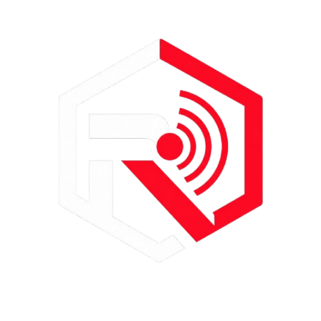

  
  <h1>RaaSHub · Android</h1>
  
<strong>Native onion source directory and live availability monitor</strong>

  

    
    
    
  

## What's included

- Optimized native Compose screens with corrected light-theme surfaces and readable contrast.
- Searchable source directory with category filters and grouped URL details.
- Independent clear-web and Tor-only onion health-check crawlers.
- Bounded work queues and throttled progress/worker updates for smoother large scans.
- Accurate HTTP 1xx–5xx classification, safer response-header limits and retained network errors.
- Local latest-scan history, notifications and dark/light appearance settings.

## Install

**Download:** `RaaSHub.apk` from the Assets section below.

- Android 8.0 (API 26) or later.
- Application ID: `com.raashub`.
- Release is signed with the repository's persistent RaaSHub release key.
- Keep the existing app installed and install this APK as an update. If Android reports a signature conflict, stop and verify the signing certificate; do not uninstall the existing app.

## Source archives

Use GitHub's automatically generated **Source code (zip)** and **Source code (tar.gz)** links below the Assets section.

## Network & safety

Clear-web URLs are checked directly. `.onion` URLs are checked only through the local Tor SOCKS proxy. An HTTP response is an availability signal, not a trust or safety rating. RaaSHub is a source directory and health checker, not a full Tor browser or device-wide VPN.
